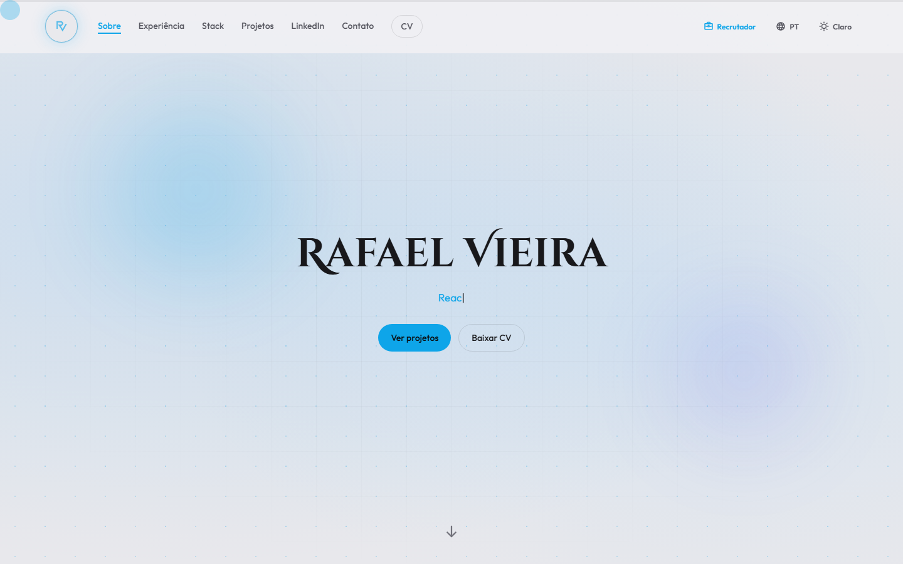
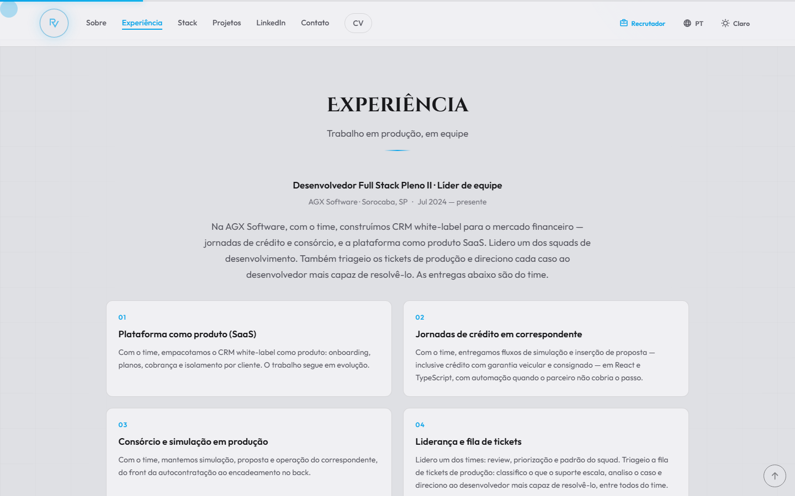
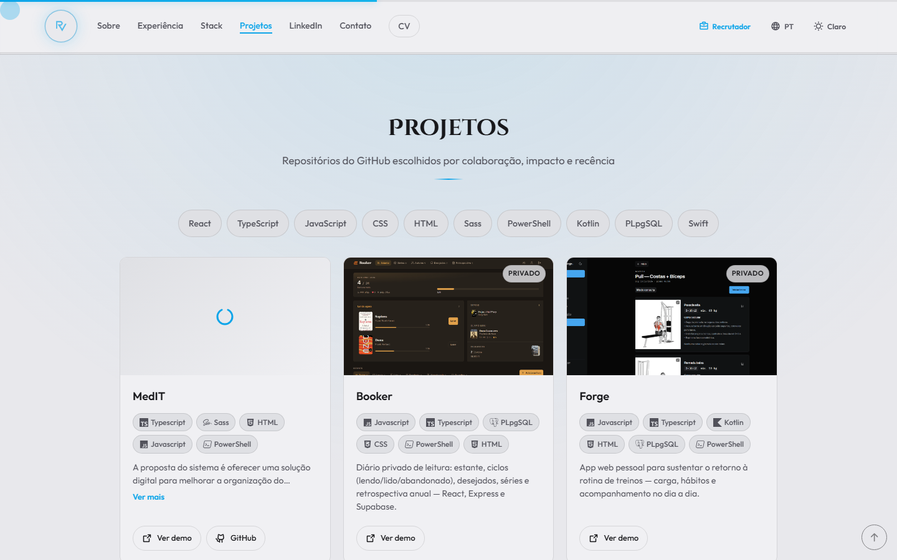
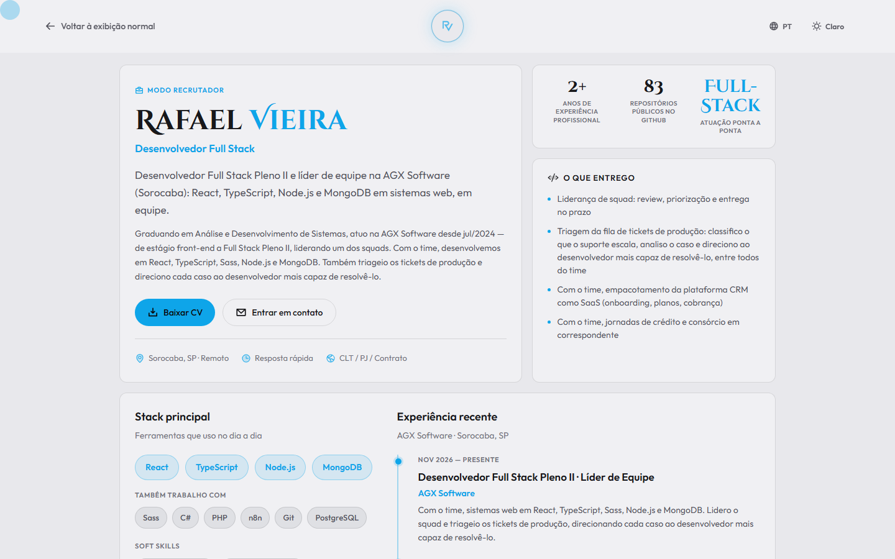
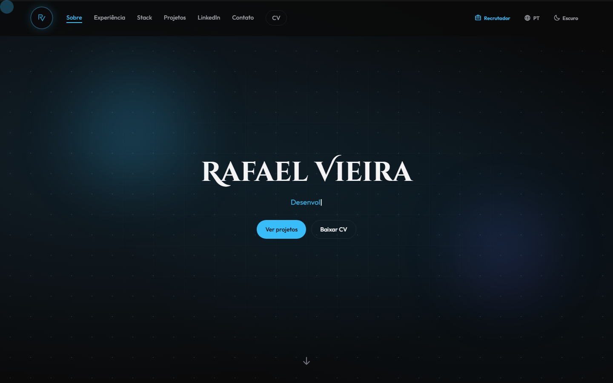

<p align="center">
  <strong>Portfolio · Rafael Vieira</strong>
</p>

<p align="center">
  <strong>Full-Stack in production, as a team.</strong><br>
  One page: profile, AGX experience, stack, GitHub projects and contact — plus recruiter mode.
</p>

<p align="center">
  
  
  
  
  
</p>

<p align="center">
  <picture>
    <source media="(prefers-color-scheme: dark)" srcset="assets/screenshots/inicio-escuro.png">
    
  </picture>
</p>

<p align="center">
  <a href="README.md">🇧🇷 Português</a> · 🇺🇸 English
</p>

## 🤔 The problem

A PDF CV and LinkedIn do not show production work or demos. Recruiters need a fast triage; visitors need PT/EN and theme without friction.

**This portfolio** is the single page that does both: Full-Stack narrative + condensed `/recruiter`.

## ✨ What only it guarantees

| | |
|---|---|
| 🧭 **One page, clear anchors** | About, Experience, Stack, Projects, Contact — navbar scroll spy. |
| 🧳 **Recruiter mode** | `/recruiter`: profile, deliveries, stack and featured projects for triage. |
| 📌 **GitHub projects** | Pins + recent, multi AND filters, demos and hybrid curation. |
| 🌐 **PT / EN + theme** | i18next and light/dark toggle, persisted. |
| 🥚 **Eight easter eggs** | Never block content; catalog in the footer. |

## 🧭 How it's used

1. **Open** [getvieira.com](https://getvieira.com) and switch to English in the nav.
2. **Browse** the sections or hit **Recruiter** for the condensed view.
3. **Download the CV** or **send a message** via the contact modal.

<details>
<summary><strong>📸 See the screens</strong></summary>
<br>

<table>
  <tr>
    <td width="50%"><a href="assets/screenshots/inicio.png"></a><br><sub><b>Home</b>: name, typewriter and CTAs</sub></td>
    <td width="50%"><a href="assets/screenshots/experiencia.png"></a><br><sub><b>Experience</b>: AGX as a team</sub></td>
  </tr>
  <tr>
    <td width="50%"><a href="assets/screenshots/projetos.png"></a><br><sub><b>Projects</b>: GitHub grid with filters</sub></td>
    <td width="50%"><a href="assets/screenshots/recrutador.png"></a><br><sub><b>Recruiter</b>: triage in cards</sub></td>
  </tr>
  <tr>
    <td width="50%"><a href="assets/screenshots/inicio-escuro.png"></a><br><sub><b>Dark theme</b>: the same hero</sub></td>
    <td width="50%"></td>
  </tr>
</table>

</details>

## 🚀 Run it

**You need:** Node 24.x, Yarn 1 and the variables from `.env.example` (GitHub token and EmailJS for a full local demo).

```bash
yarn
cp .env.example .env
yarn dev
```

Details: [`docs/ambiente-e-operacao.md`](docs/ambiente-e-operacao.md) · [`docs/context.md`](docs/context.md).

## 🧰 Everyday commands

| Command | What for |
|---|---|
| `yarn dev` | Vite (with `git pull` + install) |
| `yarn build` | `tsc` + OG + Vite build |
| `yarn test` | Vitest |
| `yarn test:e2e` | Playwright |
| `yarn lint` | ESLint |
| `yarn lhci` | Lighthouse CI locally |

## 📚 Documentation

| For | Read |
|---|---|
| Repo state and map | [`docs/context.md`](docs/context.md) |
| Product spec | [`docs/especificacao.md`](docs/especificacao.md) |
| Routes and SEO | [`docs/frontend.md`](docs/frontend.md) |
| Tokens and type | [`docs/DESIGN.md`](docs/DESIGN.md) |
| Env and deploy | [`docs/ambiente-e-operacao.md`](docs/ambiente-e-operacao.md) |

## 🔐 Governance

- **Public** site: [getvieira.com](https://getvieira.com).
- Repository: `RafaelHDSV/Portifolio`.
- No lockup in `assets/logos/` — RV monogram in the app; skill `logo` if you want a repo SVG.
