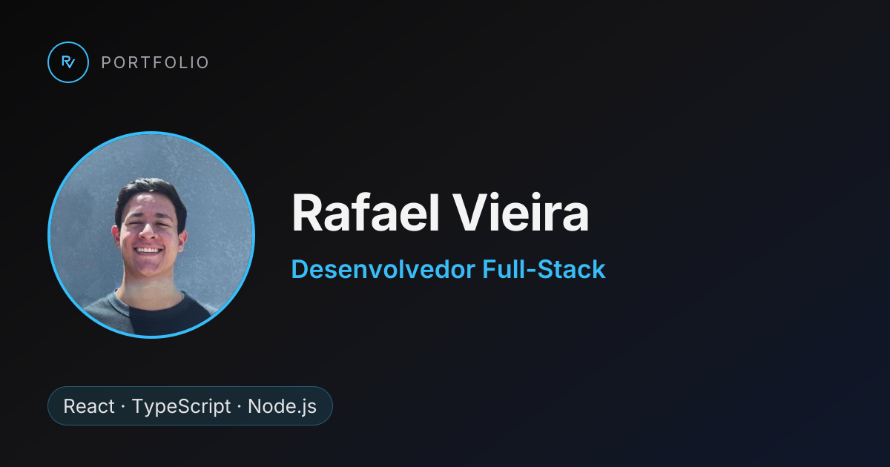

<p align="center">
  <strong>Portfólio — Rafael Vieira</strong>
</p>

<p align="center">
  <strong>Full-Stack, em uma página que conta a história certa.</strong><br />
  Projetos vivos do GitHub, modo recrutador, i18n PT/EN e SEO de verdade.
</p>

<p align="center">
  
</p>

<p align="center">
  <a href="https://getvieira.com"><b>getvieira.com</b></a>
  · React 18 · TypeScript · Vite 7 · SASS
</p>

---

## Por que este site

Currículo PDF não mostra o que está no ar. GitHub sozinho não fala em português com recrutador. Este portfólio junta perfil, experiência em produção (AGX), stack, projetos curados e contato — com um modo `/recruiter` pensado para impressão e deep link.

## O que você ganha (visitante / recrutador)

| | |
|---|---|
| **Hero e Sobre** | Headline typewriter, bio alinhada ao GitHub |
| **Experiência** | Produção em equipe: SaaS, crédito, consórcio, liderança |
| **Projetos** | Pins + recentes, filtros AND, cards 16:9, stats |
| **Contato** | Modal EmailJS + canais |
| **Modo recrutador** | `/recruiter`, print, `noindex` |
| **i18n + tema** | PT/EN · claro/escuro |
| **SEO** | OG no build (PT/EN), sitemap, robots, JSON-LD |

## Como funciona

```text
Vite SPA  →  GitHub (projetos / languages / mídia)
    ↓
seções lazy + cache de mídia  →  EmailJS no contato
    ↓
OG PNG gerado no build (satori + sharp)
```

Posts LinkedIn (quando ativos) vêm de `GET /api/linkedin-posts` com cache no Supabase — atualização pelo repo `linkedin-posts`, não na navegação do visitante.

## Demo / produção

https://getvieira.com

## Posicionamento

| Este portfólio é | Não é |
|---|---|
| Vitrine Full-Stack pessoal | Blog genérico |
| Projetos com evidência no GitHub | Lista estática eternamente desatualizada |
| Modo recrutador explícito | Só dark theme com badges |

## Stack (em uma linha)

React 18 + TypeScript + Vite 7 + SASS + Emotion + i18next + EmailJS · Vitest + Playwright + Lighthouse CI.

Detalhes: [`docs/context.md`](docs/context.md) · especificação: [`docs/especificacao.md`](docs/especificacao.md) · front: [`docs/frontend.md`](docs/frontend.md).

## Começar

Pré-requisitos, `.env` e scripts: use [`docs/ambiente-e-operacao.md`](docs/ambiente-e-operacao.md) (e `.env.example`). Setup longo não vive neste README.

Contribuição: [`CONTRIBUTING.md`](CONTRIBUTING.md) · conduta: [`CODE_OF_CONDUCT.md`](CODE_OF_CONDUCT.md) · mudanças: [`CHANGELOG.md`](CHANGELOG.md).
