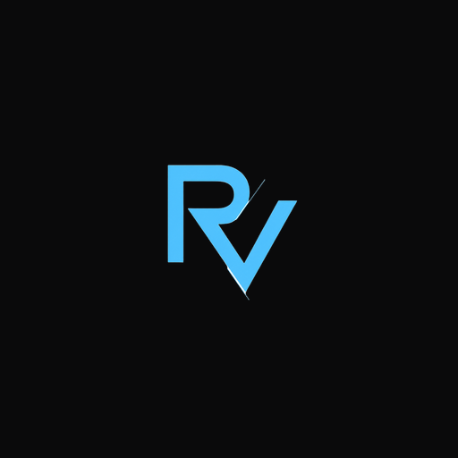
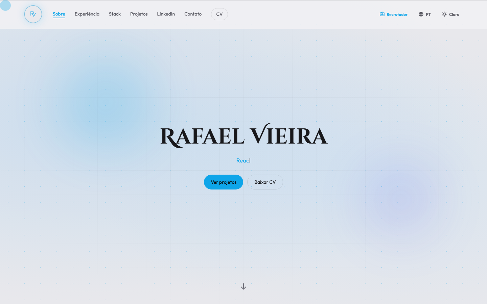
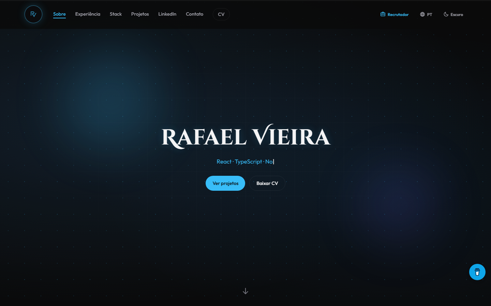
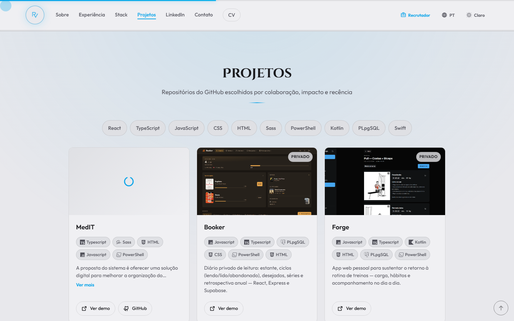
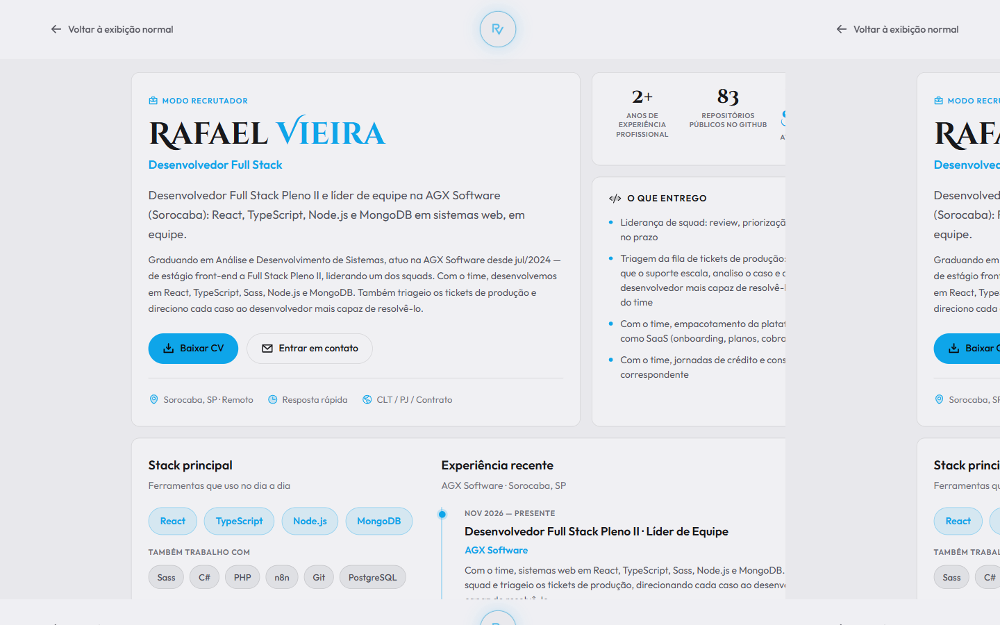
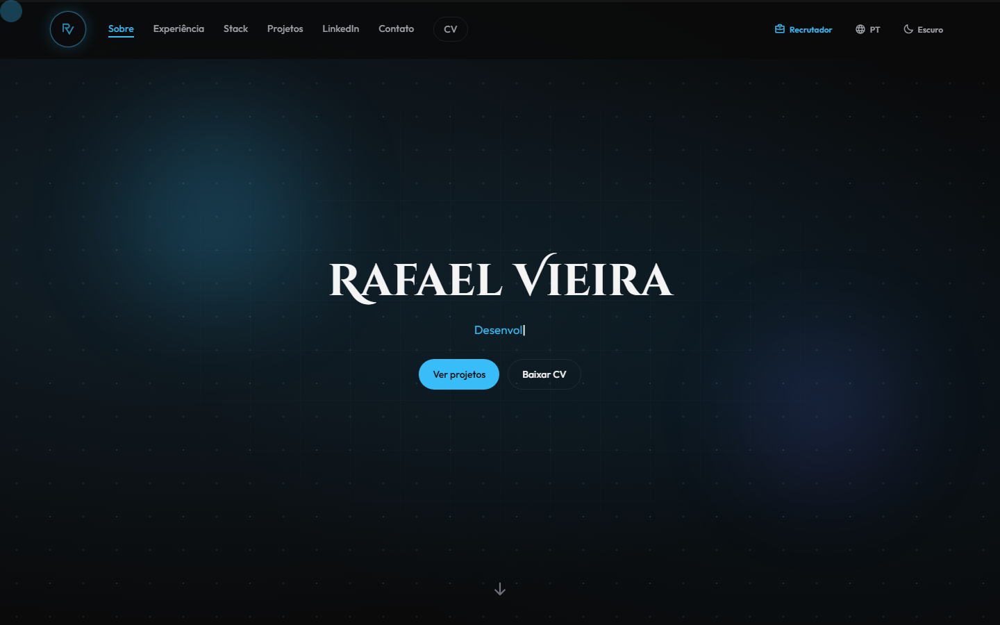

<p align="center">
  <picture>
    <source media="(prefers-color-scheme: dark)" srcset="assets/logos/logo-lockup.png">
    
  </picture>
</p>

<p align="center">
  <strong>Full-Stack em produção, em equipe.</strong><br>
  Uma página: perfil, experiência AGX, stack, projetos GitHub e contato — com modo recrutador.
</p>

<p align="center">
  
  
  
  
  
</p>

<p align="center">
  <picture>
    <source media="(prefers-color-scheme: dark)" srcset="assets/screenshots/inicio-escuro.png">
    
  </picture>
</p>

<p align="center">
  🇧🇷 Português · <a href="README.en.md">🇺🇸 English</a>
</p>

## 🤔 O problema

Currículo PDF e LinkedIn não mostram o trabalho em produção nem os projetos com demo. Recrutador precisa de uma triagem rápida; visitante precisa de PT/EN e tema sem atrito.

**Este portfólio** é a página única que faz os dois: narrativa Full-Stack + `/recruiter` condensado.

## ✨ O que só ele garante

| | |
|---|---|
| 🧭 **Uma página, âncoras claras** | Sobre, Experiência, Stack, Projetos, Contato — spy na navbar. |
| 🧳 **Modo recrutador** | `/recruiter`: perfil, entregas, stack e projetos destaque para triagem. |
| 📌 **Projetos do GitHub** | Pins + recentes, filtros multi AND, demos e curadoria híbrida. |
| 🌐 **PT / EN + tema** | i18next e toggle claro/escuro persistidos. |
| 🥚 **Oito easter eggs** | Nunca bloqueiam conteúdo; catálogo no rodapé. |

## 🧭 Como usar

1. **Abrir** [getvieira.com](https://getvieira.com).
2. **Navegar** pelas seções ou tocar **Recrutador** para a visão condensada.
3. **Baixar o CV** ou **enviar mensagem** pelo modal de contato.

<details>
<summary><strong>📸 Ver as telas</strong></summary>
<br>

<table>
  <tr>
    <td width="50%"><a href="assets/screenshots/inicio.png"></a><br><sub><b>Início</b>: nome, typewriter e CTAs</sub></td>
    <td width="50%"><a href="assets/screenshots/experiencia.png"></a><br><sub><b>Experiência</b>: AGX em equipe</sub></td>
  </tr>
  <tr>
    <td width="50%"><a href="assets/screenshots/projetos.png"></a><br><sub><b>Projetos</b>: grade GitHub com filtros</sub></td>
    <td width="50%"><a href="assets/screenshots/recrutador.png"></a><br><sub><b>Recrutador</b>: triagem em cards</sub></td>
  </tr>
  <tr>
    <td width="50%"><a href="assets/screenshots/inicio-escuro.png"></a><br><sub><b>Tema escuro</b>: o mesmo hero</sub></td>
    <td width="50%"></td>
  </tr>
</table>

</details>

## 🚀 Rodar

**Precisa de:** Node 24.x, Yarn 1 e as variáveis do `.env.example` (GitHub token e EmailJS para demos locais completas).

```bash
yarn
cp .env.example .env
yarn dev
```

Detalhes: [`docs/ambiente-e-operacao.md`](docs/ambiente-e-operacao.md) · [`docs/context.md`](docs/context.md).

## 🧰 Comandos do dia a dia

| Comando | Para quê |
|---|---|
| `yarn dev` | Vite (com `git pull` + install) |
| `yarn build` | `tsc` + OG + build Vite |
| `yarn test` | Vitest |
| `yarn test:e2e` | Playwright |
| `yarn lint` | ESLint |
| `yarn lhci` | Lighthouse CI local |

## 📚 Documentação

| Para | Leia |
|---|---|
| Estado e mapa do repo | [`docs/context.md`](docs/context.md) |
| Spec de produto | [`docs/especificacao.md`](docs/especificacao.md) |
| Rotas e SEO | [`docs/frontend.md`](docs/frontend.md) |
| Tokens e tipografia | [`docs/DESIGN.md`](docs/DESIGN.md) |
| Env e deploy | [`docs/ambiente-e-operacao.md`](docs/ambiente-e-operacao.md) |

## 🔐 Governança

- Site **público**: [getvieira.com](https://getvieira.com).
- Repositório: `RafaelHDSV/Portifolio`.
- Sem lockup em `assets/logos/` — monograma RV no app; skill `logo` se quiser SVG de repositório.
